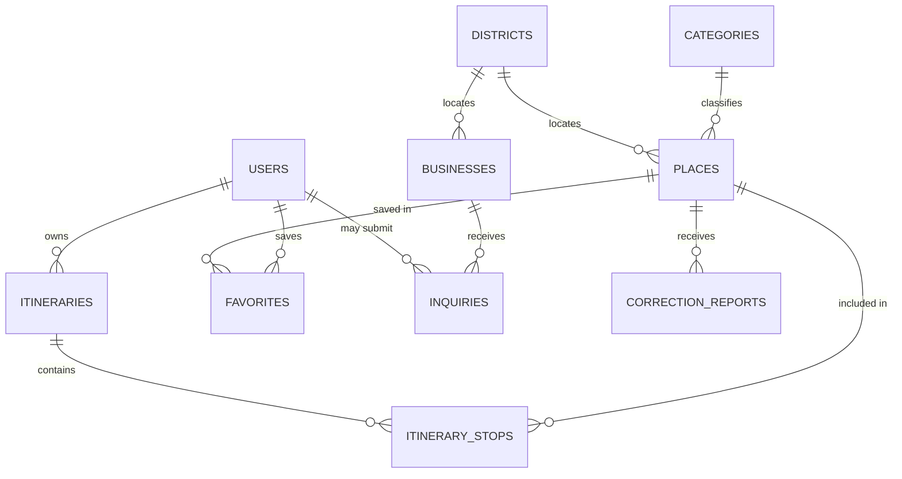

# 04 · Database Design

Database: SQLite for development (`instance/tripura_explore.db`), portable to PostgreSQL through
SQLAlchemy. Schema changes are applied with Flask-Migrate (`flask db migrate` / `flask db upgrade`).

---

## 1. Entity-relationship diagram



Relationship summary:

| A | Relationship | B |
| --- | --- | --- |
| categories | classifies | places |
| districts | locates | places / businesses |
| places | is included in | itinerary_stops |
| itineraries | contains | itinerary_stops |
| users | owns | itineraries |
| users | saves | favorites |
| places | receives | favorites / correction_reports |
| businesses | receives | inquiries |

## 2. Tables

### categories
| Column | Type | Rules |
| --- | --- | --- |
| id | integer | primary key |
| name | string(80) | unique, not null |
| slug | string(80) | unique, not null, indexed (used in URLs and filters) |
| description | text | nullable |
| icon | string(40) | nullable; maps to an inline SVG in `partials/icons.html` |

Seeded values: Nature, Heritage, Lakes, Hills, Temples, Wildlife, Culture.

### districts
| Column | Type | Rules |
| --- | --- | --- |
| id | integer | primary key |
| name | string(80) | unique, not null |
| slug | string(80) | unique, not null, indexed |
| description | text | nullable |

All eight official districts are seeded: West Tripura, Sepahijala, Khowai, Gomati, South Tripura, Dhalai,
Unakoti, North Tripura.

### places
| Column | Type | Rules |
| --- | --- | --- |
| id | integer | primary key |
| category_id | integer | FK → categories.id, not null, indexed |
| district_id | integer | FK → districts.id, nullable, indexed |
| name | string(160) | not null |
| slug | string(160) | unique, not null, indexed |
| tagline / short_description / description | string / string / text | nullable |
| locality, address | string | nullable |
| latitude, longitude | float | nullable, `CHECK` between −90/90 and −180/180, and both-or-neither |
| coordinates_verified | boolean | not null, default false |
| coordinate_source | string(300) | nullable |
| image_url, image_alt | string | nullable |
| gallery | JSON | list of `{url, alt, credit?, licence?, source_url?}` |
| entry_fee_indian / entry_fee_foreign | string(120) | nullable — **stays NULL until verified** |
| opening_info, closed_day, best_season | string | nullable — **stay NULL until verified** |
| typical_visit_hours | float | nullable — **stays NULL until verified** |
| facilities, accessibility_info, safety_notes, contact_info | string(200–300) | nullable |
| extra_tags | string(200) | comma-separated secondary interests |
| popularity | integer | not null, default 0 (internal editorial score, not a rating) |
| is_published | boolean | not null, default false |
| is_verified | boolean | not null, default false |
| verified_by, verification_notes, source_note | string/text | nullable |
| last_verified_at | date | nullable |
| created_at / updated_at | datetime | not null |

Indexes and constraints: `ix_places_published_popularity (is_published, popularity)`, unique slug,
`ck_places_latitude`, `ck_places_longitude`, `ck_places_lat_lng_together`.

### itineraries
| Column | Type | Rules |
| --- | --- | --- |
| id | integer | primary key |
| user_id | integer | FK → users.id, not null, indexed (guest plans are never persisted) |
| title | string(160) | not null |
| duration_days | integer | not null, `CHECK` between 1 and 3 |
| starting_location | string(160) | not null |
| budget | integer | nullable, `CHECK` ≥ 0 |
| interests | string(300) | comma-separated interest labels |
| travel_date | date | nullable |
| share_token | string(64) | unique, indexed, nullable |
| is_shared | boolean | not null, default false |
| generation_notes | text | short human summary of the generated plan |
| created_at / updated_at | datetime | not null |

### itinerary_stops
| Column | Type | Rules |
| --- | --- | --- |
| id | integer | primary key |
| itinerary_id | integer | FK → itineraries.id, `ON DELETE CASCADE`, not null, indexed |
| place_id | integer | FK → places.id, not null, indexed |
| day_number | integer | not null, `CHECK` 1–3 |
| stop_order | integer | not null, `CHECK` ≥ 1; renumbered by `Itinerary.normalise_stops()` |
| planned_time, notes | string | nullable |

Constraints: `uq_stops_itinerary_place` (unique itinerary + place) prevents duplicates. A unique
(itinerary, day, order) index is deliberately **not** used, because dragging a stop inside a day would
temporarily violate it (SQLite cannot defer unique constraints).

### users
| Column | Type | Rules |
| --- | --- | --- |
| id | integer | primary key |
| name | string(120) | not null |
| email | string(180) | unique, not null, indexed, stored lower-case |
| password_hash | string(255) | not null (salted hash, never plain text) |
| role | string(20) | not null, default `user`; `admin` unlocks `/admin` |
| created_at | datetime | not null |

### favorites
| Column | Type | Rules |
| --- | --- | --- |
| id | integer | primary key |
| user_id | integer | FK → users.id, not null, indexed |
| place_id | integer | FK → places.id, not null, indexed |
| created_at | datetime | not null |

Constraint `uq_favorites_user_place` prevents duplicates.

### businesses
| Column | Type | Rules |
| --- | --- | --- |
| id | integer | primary key |
| district_id | integer | FK → districts.id, nullable, indexed |
| name, slug | string | slug unique + indexed, name not null |
| category | string(60) | one of Homestay, Local Guide, Restaurant, Transport, Handicrafts, Cultural Experience |
| short_description, description | string/text | nullable |
| locality, address | string | nullable |
| latitude, longitude | float | nullable |
| contact_name, contact_phone, contact_email, languages, price_note | string | nullable, only published when authorised |
| image_url, image_alt | string | nullable |
| approval_status | string(20) | not null, default `pending`, indexed (`pending`/`approved`/`rejected`) |
| status_note | string(300) | nullable, internal |
| verified_on | date | nullable |
| created_at / updated_at | datetime | not null |

### inquiries
| Column | Type | Rules |
| --- | --- | --- |
| id | integer | primary key |
| business_id | integer | FK → businesses.id, not null, indexed |
| user_id | integer | FK → users.id, nullable (guests may inquire) |
| name, email | string | not null, email validated |
| phone | string(40) | nullable |
| message | text | not null, 10–1200 characters |
| status | string(20) | not null, default `new` (`new`/`in_progress`/`closed`), indexed |
| admin_note | string(300) | nullable |
| created_at / updated_at | datetime | not null |

### correction_reports
| Column | Type | Rules |
| --- | --- | --- |
| id | integer | primary key |
| place_id | integer | FK → places.id, not null, indexed |
| message | text | not null |
| reporter_email | string(180) | nullable |
| status | string(20) | not null, default `new` (`new`/`reviewing`/`resolved`/`rejected`), indexed |
| admin_note | string(300) | nullable |
| created_at / updated_at | datetime | not null |

## 3. Sample records

```text
categories   (7)   Nature · Heritage · Lakes · Hills · Temples · Wildlife · Culture
districts    (8)   West Tripura · Sepahijala · Khowai · Gomati · South Tripura · Dhalai · Unakoti · North Tripura
places      (16)   15 published + 1 unpublished draft ("Neermahal Boat Ghat (draft record)")
businesses   (6)   4 approved demo listings + 2 pending demo listings
users        (n)   created by `flask create-admin` / registration
```

Example `places` row (abridged):

| name | slug | category | district | locality | lat | lng | entry_fee_indian | opening_info | is_published | is_verified |
| --- | --- | --- | --- | --- | --- | --- | --- | --- | --- | --- |
| Neermahal | neermahal | Heritage | Sepahijala | Melaghar | 23.4929 | 91.3145 | NULL | NULL | true | false |

The NULLs are the point: fees and hours stay empty until the managing authority confirms them.

## 4. Data provenance and verification policy

1. Every destination row stores `source_note`, `coordinate_source`, `verification_notes`, `verified_by` and
   `last_verified_at`.
2. `coordinates_verified` is separate from `is_verified`: a record can be described accurately while its
   GPS reading is still outstanding (this is the state of the whole seed dataset).
3. A boolean "verified" badge requires a named person; the admin form refuses to save `is_verified` without
   `verified_by`.
4. Unpublished rows are invisible to every public endpoint.
5. Fees, hours and seasons are re-verified every six months; the report generator will list rows whose
   `last_verified_at` is older than 180 days.
6. No rating, review count or visitor number is stored at all, because none exists yet.

See [`DATA-VERIFICATION.md`](DATA-VERIFICATION.md) for the per-record checklist and
[`KNOWN-LIMITATIONS.md`](KNOWN-LIMITATIONS.md) for the consequences.

## 5. Migration policy

* Development: `flask init-db` uses `db.create_all()` for speed.
* Any schema change after a release: `flask db migrate -m "message"` then `flask db upgrade`, committed to
  `migrations/`.
* `flask reset-db --yes` is the only destructive command and asks for confirmation unless `--yes` is given.
* `seed-data` is idempotent (records are looked up by slug), so it can safely run again after a partial
  failure.