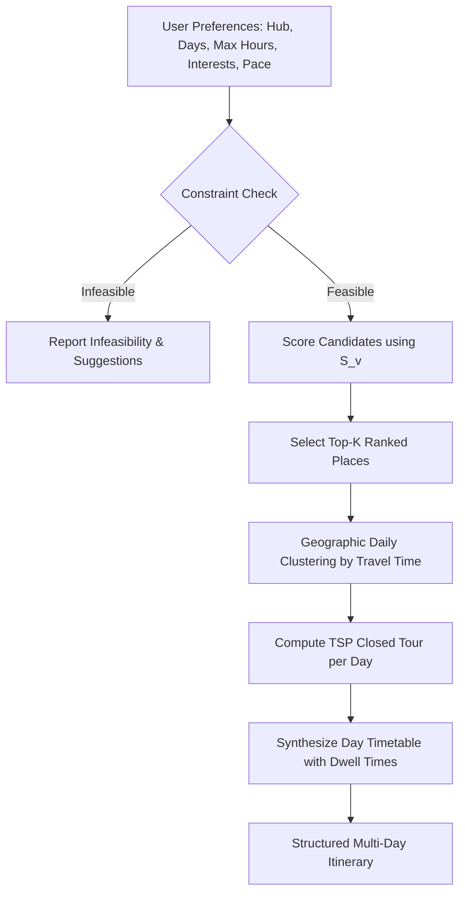

# Route Optimization & Multi-Day Itinerary Synthesis

## 1. Multi-Objective Comparison Framework

Trip planning rarely involves a single dimension. A traveler may prefer:
- **Fastest Highway Route**: Minimizes travel time by prioritizing multi-lane national highways (e.g. NH-8), even if total distance is slightly greater.
- **Shortest Distance Route**: Minimizes odometer mileage by using direct bypasses and rural connectors.
- **Most Economical Route**: Minimizes total financial expenditure (fuel consumption at ₹12/km plus bridge tolls).
- **Balanced Compromise**: Normalizes all three objectives to find a harmonic equilibrium.

### Empirical Pareto Analysis
The `RouteOptimizationService` generates candidate routes under each objective and checks mutual dominance. 
- If Route $A$ has lower time and lower distance than Route $B$ at the same cost, $B$ is **dominated** and marked as suboptimal.
- If Route $A$ has lower time but higher distance than Route $B$, neither dominates the other; both are declared **Pareto Optimal** and presented to the traveler side-by-side with trade-off annotations.

---

## 2. Personalized Multi-Day Journey Synthesizer

The `PersonalizationService` generates realistic, day-by-day itineraries that account for travel fatigue, opening hours, and geographic clustering.

### Algorithm Steps:

### 1. Pace-Dependent Limits
- **Relaxed**: Max 2 destinations/day, max 4.5 road travel hours/day. Typical dwell time: 2–3 hours.
- **Balanced (Moderate)**: Max 3 destinations/day, max 6.0 road travel hours/day. Typical dwell time: 1.5–2 hours.
- **Packed (Fast-paced)**: Max 4 destinations/day, max 8.0 road travel hours/day. Typical dwell time: 1 hour.

### 2. Dwell Time Model
Each place record has a `typical_visit_hours` field (defaulting to 1.5 hours). The synthesizer tracks elapsed day minutes:
$$\text{Time}_{\text{cumulative}} = \text{Departure (08:30)} + \sum (\text{Drive Time}_{\text{leg}} + \text{Dwell Time}_{\text{destination}})$$
Ensures travelers return to their base hotel before dark (18:30–19:30).

---

## 3. Infeasibility Detection & Constraint Validation

If user constraints cannot be satisfied, the system gracefully detects conflicts and returns helpful recommendations instead of failing:
1. **Excessive Must-Visit Stops**: If a traveler selects 5 must-visit places for a 1-day trip, the planner explains that only 2–3 stops can fit within safe driving limits and suggests increasing the trip duration or switching pace.
2. **Accessibility Conflicts**: If wheelchair accessibility is required and a selected destination has recorded terrain obstacles, the conflict is surfaced explicitly.
3. **Budget Exceeded**: If total estimated fuel/toll costs exceed the traveler's stated budget, warnings recommend closer destinations or public transport.
