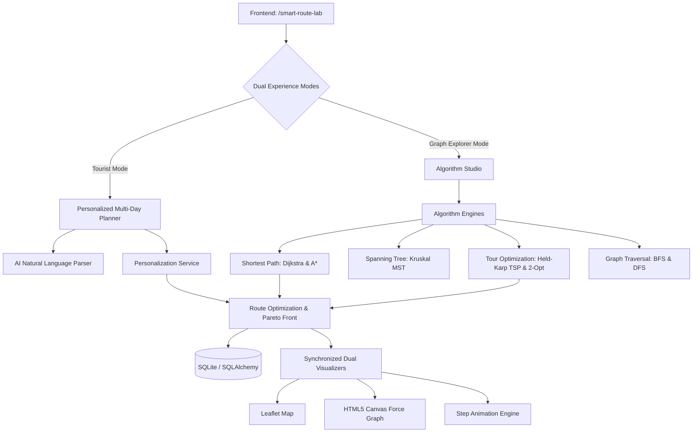

# Smart Route Lab — System Overview & Architecture

## 1. Executive Summary

**Smart Route Lab** is a full-stack, mathematically rigorous journey optimization and graph theory laboratory integrated natively into the **Tripura Explorer** platform. It models the authentic road network of Tripura, India, as a weighted graph $G = (V, E)$, enabling both everyday travelers and algorithm enthusiasts to compute, analyze, and visualize journeys using exact algorithms and multi-objective optimization.

The lab is live at `/smart-route-lab`.

---

## 2. Core Capabilities & Architecture

### Dual Experience Modes
1. **Tourist Mode**:
   - Focuses on practical travel decisions: origin hub, trip duration (1–4 days), daily road driving limits (4h, 6h, 8h), interest themes (Heritage, Spiritual, Nature, Wildlife), travel pace, and optimization objectives.
   - Natural language journey assistant allows entering plain-English requests (e.g., *"3 days spiritual and lake journey from Agartala under 250 km"*).
   - Generates day-by-day structured timelines with dwell times, driving legs, and road travel budgets.
2. **Graph Explorer Mode**:
   - An interactive mathematical laboratory.
   - Allows users to pick specific algorithms (Dijkstra, A*, Kruskal's MST, Held-Karp TSP, BFS, DFS) and inspect vertex relaxations, priority queue states, and open/closed sets step-by-step.
   - Educational callouts display exact time/space complexity and correctness guarantees.

---

## 3. Synchronized Dual Visualizers

The workstation features side-by-side synchronized visualization:
- **Leaflet Geographic Map**:
  - Displays authentic GPS coordinates of Tripura destinations.
  - Draws highway corridors along authentic alignments (NH-8, NH-108B, Amarpur-Gandacherra, Kumarghat-Kailashahar, Kanchanpur-Jampui).
  - Highlights active paths, frontier edges, and tree branches with custom SVG markers and color-coded polylines.
- **HTML5 Canvas Force-Directed Graph**:
  - Abstract planar topology representation $G = (V, E)$.
  - Physics-based spring-electrical simulation (repulsion, spring tension, and damping).
  - Interactive drag-and-drop node positioning, hover weight tooltips, and real-time state highlighting.
- **Synchronized Camera & State**:
  - Selecting or hovering over a vertex in either visualizer highlights the counterpart in real time.
  - View switcher provides "Split View", "Map Only", and "Graph Only" modes with responsive reflow.

---

## 4. Step-by-Step Algorithm Playback Engine

All algorithms return execution traces comprising step snapshots:
- **Actions Recorded**: Initialization, queue push/pop, edge relaxation, MST edge acceptance/cycle rejection, TSP tour steps, and BFS/DFS discovery.
- **Interactive Controls**: Play, Pause, Step Next, Step Previous, Reset, and Playback Speed (0.5x, 1x, 2x, 4x).
- **Educational Callout**: Live text explanation updates at every step to explain the algorithmic mechanism.
- **State Traces**: Live Priority Queue / Open Set $Q$ and Visited / Closed Set $S$ inspection tables in Explorer Mode.

---

## 5. Technology Stack & Integration

- **Backend**: Python 3.12, Flask, Flask-SQLAlchemy, SQLite, Werkzeug.
- **Algorithms**: Pure Python implementation with zero third-party graph dependencies (all graph data structures, heaps, bitmask DP, and heuristics built in `app/services/`).
- **Frontend**: Leaflet 1.9.4, HTML5 Canvas 2D, KaTeX 0.16.9 for mathematical typography, vanilla ES6 modules.
- **Security**: CSRF tokens with machine-to-machine AJAX exemptions, authenticated/tokenized route saving, SQL injection prevention via SQLAlchemy parameterized queries.
